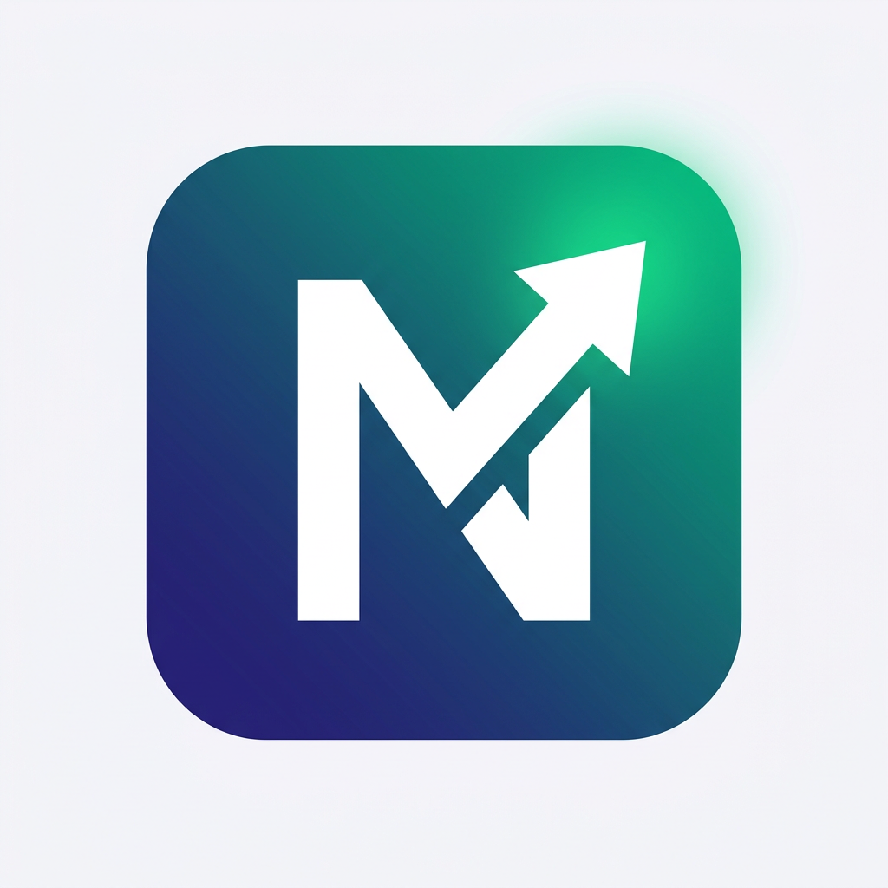
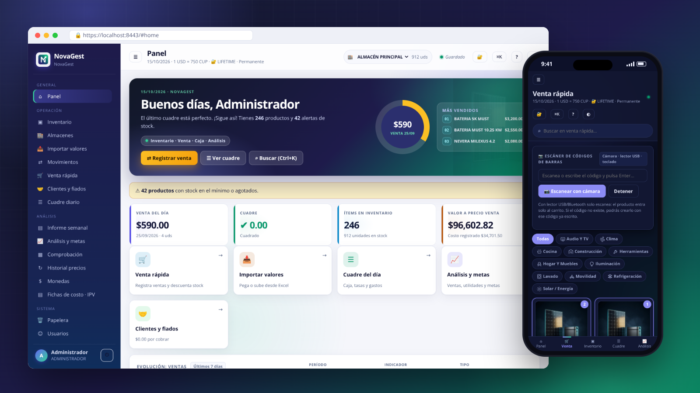
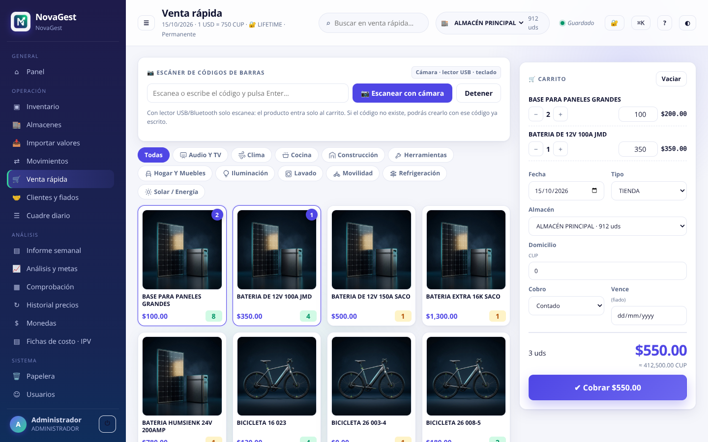
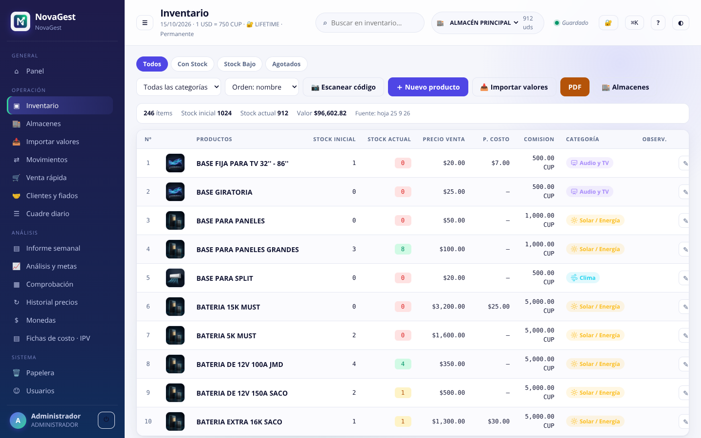
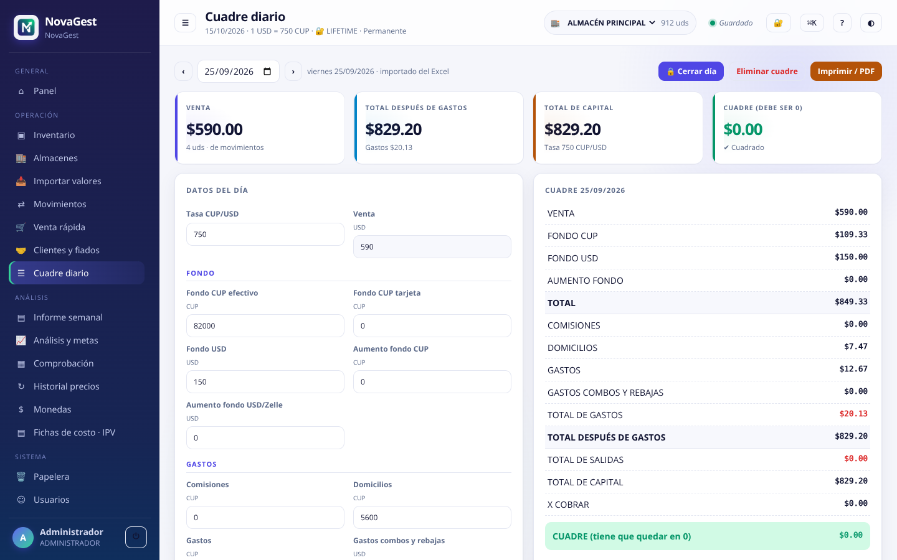
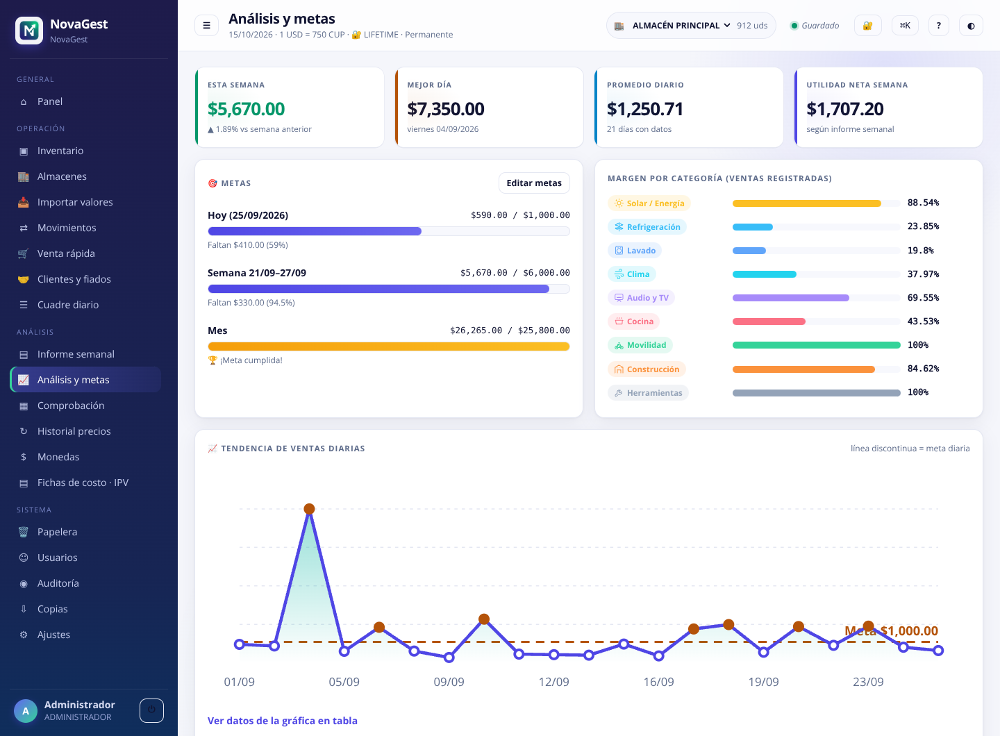
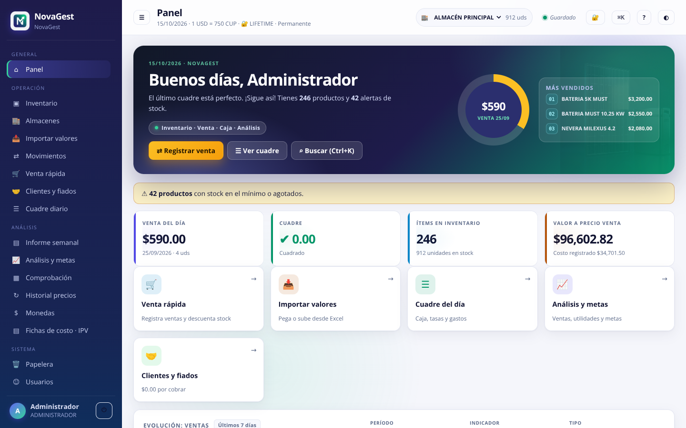
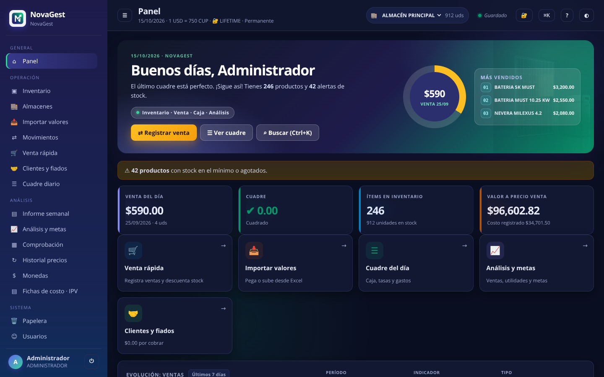
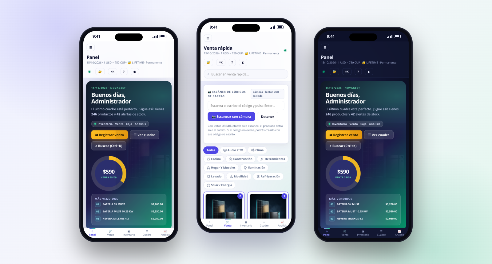

<div align="center">



# NovaGest

### Gestiona. Crece. Avanza.

**Inventario, punto de venta, caja diaria e informes para tu negocio — en la Web, en Android y sin conexión.**

🌐 **Español** · [English](docs/readme/README_en.md) · [Português](docs/readme/README_pt-BR.md) · [Français](docs/readme/README_fr.md) · [Italiano](docs/readme/README_it.md) · [Deutsch](docs/readme/README_de.md) · [Русский](docs/readme/README_ru.md) · [简体中文](docs/readme/README_zh-CN.md)

[](CHANGELOG.md)
[](#-qué-incluye)
[](#-preguntas-frecuentes)
[](#-inicio-rápido)
[](app/)
[](server/)
[](LICENSE)

[Funciones](#-funciones) · [Capturas](#-capturas) · [Inicio rápido](#-inicio-rápido) · [Documentación](#-documentación) · [Preguntas frecuentes](#-preguntas-frecuentes) · [Seguridad](#-seguridad) · [Licencia](#-licencia)

</div>

<p align="center">
  
</p>

> [!TIP]
> **¿Primera vez?** El [Manual de Usuario](docs/MANUAL_USUARIO.md) explica el sistema completo
> paso a paso ([versión imprimible en HTML](docs/MANUAL_USUARIO.html)), y el
> [video de presentación de 2:50 min](docs/assets/video/novagest-promo-720p.mp4) resume en
> seis pasos cómo trabajar con la Web y con Android.

> [!IMPORTANT]
> **NovaGest es software propietario.** El código es visible en GitHub, pero usarlo en un negocio, copiarlo, modificarlo o distribuirlo requiere una **licencia de uso** del titular. Consulta [LICENSE](LICENSE) y la sección [Licencia](#-licencia).

## 💡 ¿Qué es NovaGest?

**NovaGest** reúne en un solo lugar lo que tu negocio necesita todos los días: **inventario multialmacén**, **punto de venta**, **caja diaria** e **informes con análisis**. Nada de hojas sueltas ni cuadernos: la aplicación Web se instala como app y sigue funcionando si se cae la conexión, la app Android lleva la operación al bolsillo y el servidor compartido mantiene a todos trabajando sobre el mismo estado en tiempo real — con licencia de uso, roles, auditoría y copias de seguridad.

> 📊 **Tus datos mandan.** Los libros de Excel son solo fuentes de importación y referencia: la aplicación nunca importa ni sustituye datos operativos sin mostrarte una **vista previa** y recibir tu confirmación. Una instalación nueva puede arrancar con la semilla incluida en el proyecto.

## 🧩 Qué incluye

| Aplicación | Qué haces con ella |
|---|---|
| 🌐 **Web (PWA)** | El centro de mando: inventario, almacenes, importación de valores, movimientos, venta rápida, cuadre diario, informe semanal, comprobación y administración — con búsqueda global (`Ctrl+K`), guía integrada, atajos de teclado y modo claro/oscuro. Se instala como aplicación y abre sin conexión. |
| 📱 **Android** | La operación en movimiento: la misma gestión con Kotlin + Jetpack Compose, almacenamiento local, desbloqueo biométrico y sincronización con el servidor cuando hay conexión. |
| 🗄️ **Servidor** | El corazón que une todo: API y sitio Web en un solo proceso de Python, datos compartidos en SQLite, sesiones y permisos validados en el servidor, licencias firmadas, auditoría y copias cifradas automáticas. |

## ✨ Funciones

- 📦 **Inventario multialmacén** — cada almacén conserva sus propias existencias y el inventario general suma todos; importa valores, traspasa mercancía entre almacenes y ajusta diferencias con historial completo.
- 🛒 **Punto de venta** — venta rápida que descuenta el stock del almacén en uso al instante, con **escáner de códigos de barras** (cámara o lector USB/Bluetooth), cobro **al contado o a fiado** a un cliente, y comisiones y domicilios calculados automáticamente.
- 🤝 **Clientes y fiados** — libro de clientes con límite de crédito, cuentas por cobrar con vencimiento, estados (pendiente/parcial/vencido/pagado) y **abonos** con historial; el total por cobrar se ve en el Panel.
- 🧮 **Caja diaria (cuadre)** — tasas CUP/USD y MXN/USD, cobros, entradas, extracciones, fondos y gastos: el día está «cuadrado» cuando el resultado da 0, y la aplicación te avisa si no lo está.
- 🔄 **Movimientos** — ventas, entradas y salidas con almacén, centro de venta, cantidades, importes y observaciones; cada movimiento recalcula el stock y queda registrado.
- 🧾 **Fichas de Costo e IPV** — ficha versionada por producto o servicio (componentes del propio inventario, costo total, rendimiento y costo por ración) con flujo Borrador → Aprobada, y **Control IPV** por período (`IPV-AAAA-NNNN`) que se valida contra la ficha. Web: **Fichas de costo · IPV**; Android: consulta sincronizada. Adaptado de [IPV · Fichas y Costos](https://github.com/yhquintero/IPV_Fichas-Costos); los importes se guardan en la moneda de cada ficha (USD o CUP).
- 📊 **Informes y comprobación** — cuadres diarios, resumen semanal y comprobación de inventario por día, semana, mes, año o rango personalizado, con exportación CSV/PDF lista para imprimir o enviar al contador.
- 📈 **Análisis y metas** — ventas por período, utilidad bruta y neta, valor del inventario a precio de venta y a costo, y progreso frente a metas diarias y semanales.
- 🕵️ **Historial y auditoría** — precios, costos y tasas por día; registro de quién hizo qué y cuándo, según el rol de cada usuario.
- ☁️ **Sincronización multiplataforma** — Web y Android trabajan sobre el mismo estado; si se pierde la conexión, la Web sigue operando y sincroniza al reconectar.
- 🔐 **Seguridad de nivel empresarial** — licencia de uso firmada criptográficamente, verificación en dos pasos (TOTP), bloqueo tras intentos fallidos, cierre de días y copias de seguridad cifradas.

## 📸 Capturas

<table>
  <tr>
    <td width="50%" valign="top"><br /><sub><b>Venta rápida</b> — escáner de códigos, carrito y cobro al contado o a fiado.</sub></td>
    <td width="50%" valign="top"><br /><sub><b>Inventario</b> — existencias por almacén, precios, costos, comisiones y categorías.</sub></td>
  </tr>
  <tr>
    <td width="50%" valign="top"><br /><sub><b>Cuadre diario</b> — tasas CUP/USD, fondos y gastos; el resultado debe quedar en 0.</sub></td>
    <td width="50%" valign="top"><br /><sub><b>Análisis y metas</b> — indicadores, metas, margen por categoría y tendencia diaria.</sub></td>
  </tr>
  <tr>
    <td width="50%" valign="top"><br /><sub><b>Panel</b> — resumen del día, alertas de stock y accesos directos (modo claro).</sub></td>
    <td width="50%" valign="top"><br /><sub><b>Panel</b> — el mismo resumen en modo oscuro.</sub></td>
  </tr>
</table>

<p align="center">
  
  <br /><sub>La aplicación Web en el móvil: navegación inferior, instalable como app (PWA). Capturas con los datos de demostración del proyecto.</sub>
</p>

## 🚀 Inicio rápido

### Servidor y aplicación Web

```bash
python3 -m pip install -r requirements.txt   # Python 3.10 o posterior
python3 server/novagest_server.py            # Web + API en http://localhost:8080

# En otra terminal: clave para esta instalación
python3 tools/generate_license.py --client "Mi Tienda" --term MES
```

Abre `http://localhost:8080`, pega la clave en la pantalla **Licencia de Uso** y entra con una de las cuentas de demostración. Una instalación nueva queda bloqueada hasta activar una clave válida: el sistema completo se explica en [docs/LICENCIAS.md](docs/LICENCIAS.md).

<details>
<summary><b>Cuentas de demostración (solo para pruebas locales)</b></summary>

<br />

En una base de datos nueva se crean estas cuentas (ya no se muestran en la pantalla de acceso):

| Usuario | Contraseña inicial | Rol |
|---|---|---|
| `admin` | `Admin123!` | Administrador |
| `jefe` | `Jefe123!` | Jefe |
| `economico` | `Eco123!` | Económico |
| `almacenero` | `Alma123!` | Almacenero |

El rol Administrador debe activar la verificación en dos pasos al entrar (`REQUIRE_ADMIN_TOTP=1`, por defecto).

</details>

> [!WARNING]
> **Cambia las contraseñas iniciales antes de usar el sistema con datos reales.** En producción arranca el servidor con `NOVAGEST_DEMO_USERS=0 NOVAGEST_ADMIN_PASSWORD=<secreta, mín. 10>`, usa siempre HTTPS y conserva las claves de cifrado fuera del servidor. Lista completa en [SECURITY.md](SECURITY.md#-recomendaciones-para-producción).

### Windows con HTTPS (una laptop)

```powershell
powershell -ExecutionPolicy Bypass -File .\server\iniciar-https.ps1
```

Crea el certificado con mkcert, abre el Firewall del puerto 8443 y arranca el **Panel de Control Visual** (icono en la bandeja del sistema) con el servidor y el generador de licencias en segundo plano.

### Docker con dominio propio

```bash
DOMINIO=tienda.ejemplo.com docker compose -f deploy/docker-compose.yml up -d
```

### Android

Abre la raíz del proyecto en Android Studio (JDK 17 y Gradle 8.9), ejecuta la configuración `app` y configura en el acceso la dirección HTTPS del servidor para sincronizar.

📖 Guía paso a paso — HTTPS, Panel de Control Visual, Docker, Android y producción: [docs/INSTALACION.md](docs/INSTALACION.md).

## 📥 Importar los libros Excel

Las importaciones se inician desde la interfaz y muestran una **vista previa** antes de guardar. No sustituyen movimientos ni se ejecutan automáticamente al abrir la aplicación.

| Libro en `xlsx/` | Dónde se aplica | Qué conserva |
|---|---|---|
| `NovaGest SEPT.xlsx` | Web → **Copias** → importar libro | Detecta y permite importar en orden cronológico todas las hojas diarias seleccionadas: existencias, entradas, salidas, ventas, tasa y cuadre. La fecha proviene del nombre de la hoja. Las diferencias de apertura/cierre se anotan como ajustes explícitos; reimportar sustituye cada lote. También alimenta las semillas del proyecto. |
| `NOVA PINAR.xlsx`, `NOVA CONSOLACION.xlsx`, `NOVA HERRADURA.xlsx` | Web → **Copias** → importar libro | Importación masiva de sus hojas diarias con fecha, almacén y selección corregibles. Advierte fechas vacías y duplicadas antes de guardar. Conserva importe real, costo unitario y comisión CUP por venta y crea referencias financieras diarias para revisar diferencias de caja y existencias. |
| `PCH.xlsx` | Web → **Importar valores** → subir archivo | Se elige una de las ubicaciones **Pinar del Río**, **Consolación** o **Herradura** y se importan sus existencias al almacén de destino. Los nombres repetidos se consolidan sumando stock. No modifica precios globales, pues varían por ubicación. |
| `RESUMEN POR SEMANA PINAR.xlsx` | Web → **Informe semanal** → **Importar resumen Excel** | Lee la hoja `PINAR`, muestra semanas, fechas y totales antes de guardar y conserva cada semana como referencia del Excel, sin reemplazar movimientos, cuadres ni cálculos de la aplicación. |

📅 **Año del resumen semanal:** el libro semanal no imprime el año. La importación propone el año de la última fecha con datos (o el año actual si no hay fecha) y lo enseña en la vista previa antes de guardar.

Además, el módulo **Importar valores** admite pegar columnas desde Excel, subir `.xlsx`, `.csv`, `.tsv` o `.txt`, o escribir filas a mano: eliges el almacén de destino, revisas los cambios y decides si se sobrescriben valores existentes o solo se completan los que faltan. Las columnas vacías no alteran datos guardados.

📖 Guías: [Almacenes e importación](docs/ALMACENES.md) · [Manual rápido](docs/MANUAL.md) · [Mapeo del Excel](docs/MAPEO_EXCEL.md).

## 📑 Informes y PDF

- **Web:** desde Inventario, Movimientos, Almacenes, Cuadre diario, Informe semanal o Comprobación puedes imprimir o guardar como PDF los datos visibles o el almacén elegido. En Comprobación eliges día, semana, mes, año o fechas **Desde/Hasta** y filtras por almacén: el informe compara existencias de apertura/cierre con los movimientos y usa los importes y costos históricos por venta. La impresión aplica página A4 horizontal, encabezado con el negocio y el período, y oculta los controles.
- **Android:** Cuadre diario permite **Exportar cuadre a PDF** y Reportes permite **Exportar comprobación PDF**, con encabezados, cifras clave, tablas paginadas y pie de página, que se comparten con el diálogo estándar de Android. También hay exportaciones CSV y Excel de la comprobación —con costo, utilidad y comisión— y CSV de movimientos con el costo de cada momento.

## 🔑 Licencias de uso del producto

NovaGest se activa con una **clave de licencia firmada** (HMAC-SHA256, prefijo `NG-`) que cada instalación verifica con su propio secreto.

- **Ocho plazos** — día, semana, mes, trimestre, semestre, año, dos años o permanente; tipos FULL, TRIAL, ENTERPRISE y LIFETIME.
- **Solicitud por WhatsApp** — desde la pantalla **Licencia de Uso** (Web y Android) el cliente pide su plan y la solicitud queda registrada en el servidor.
- **Cuatro formas de emitir claves** — el panel 🔐 **Gestionar licencia** de la Web, el generador independiente `tools/license_studio.py` (HTTPS en su propio puerto), la terminal `tools/generate_license.py` y la API `POST /api/license/generate`.
- **Control total** — licencias emitidas, equipos activados, renovación, revocación y exportación CSV, todo anotado en la auditoría.

📖 Guía completa: [docs/LICENCIAS.md](docs/LICENCIAS.md).

## 🔒 Seguridad

- **Cuentas** — contraseñas PBKDF2-SHA256 (210 000 iteraciones), bloqueo de 5 minutos tras 5 intentos fallidos, verificación en dos pasos (TOTP) obligatoria por defecto para el Administrador y códigos de recuperación.
- **Sesiones y permisos** — sesiones con caducidad por inactividad y por duración máxima, permisos validados en el servidor, cabecera anti-CSRF y límite de peticiones por IP en acceso, recuperación y solicitudes de licencia.
- **Datos** — copias cifradas automáticas cada día con rotación, réplica opcional fuera del equipo (`BACKUP_MIRROR_DIRS`, regla 3-2-1), cierre de días y auditoría.
- **Web** — cabeceras CSP, `X-Frame-Options`, `nosniff`, `Referrer-Policy` y HSTS cuando se sirve por HTTPS.

Los datos legales públicos (#legal) se rellenan en **Ajustes → Datos legales** — guía: [docs/GUIA_DATOS_LEGALES.md](docs/GUIA_DATOS_LEGALES.md). ¿Encontraste una vulnerabilidad? **No abras un issue público**: sigue la [política de seguridad](SECURITY.md).

## ✅ Pruebas

Las mismas comprobaciones que ejecuta la integración continua (`.github/workflows/ci.yml`), desde la raíz del repositorio:

```bash
# Web e IPV (Node 22)
node tools/test_ipv.mjs && node tools/test_calc.mjs && node tools/cobertura.mjs --min 80
node tools/test_accesibilidad.mjs
npm --prefix tools install --ignore-scripts && node tools/test_axe.mjs
node tools/test_generador_ui.mjs && node tools/test_almacenes.mjs && node tools/test_customers_credits.mjs
node tools/test_excel_sources.mjs && node tools/smoke_web.mjs

# Servidor y herramientas (Python)
python3 tools/test_licencia.py && python3 tools/test_generador.py
python3 tools/test_seguridad_servidor.py && python3 tools/test_restauracion.py
python3 tools/test_carga.py --n 12

# Panel de Control Visual (PowerShell 7) y Android (JDK 17 + Gradle 8.9)
pwsh -NoProfile -File tools/test_panel_control.ps1
gradle testDebugUnitTest
```

## 📁 Estructura del proyecto

```text
app/       Aplicación Android (Kotlin + Jetpack Compose)
web/       Interfaz Web, lógica y recursos (PWA sin proceso de compilación)
server/    API, autenticación, SQLite, copias y lanzadores para Windows (Python, PowerShell)
tools/     Pruebas, importación de Excel y generador/control de licencias
deploy/    Docker Compose + Caddy para publicar con HTTPS y dominio propio
docs/      Manuales, guías legales y de cumplimiento, traducciones y capturas
xlsx/      Libros Excel de referencia para importar
brand/     Logotipo de NovaGest
venv/      Librerías de Python para Windows sin conexión (ver venv/README.md)
```

La base de datos operativa, las copias, los certificados y las claves generadas (`data/`, `certs/`) se mantienen fuera del control de versiones.

## 📚 Documentación

| Documento | Contenido |
|---|---|
| [Instalación y despliegue](docs/INSTALACION.md) | Servidor, Windows con HTTPS y Panel de Control Visual, Docker, Android y producción |
| [Licencias de uso](docs/LICENCIAS.md) | Activación, plazos, solicitudes por WhatsApp, generador independiente y control de claves |
| [**Manual de Usuario**](docs/MANUAL_USUARIO.md) · [versión imprimible](docs/MANUAL_USUARIO.html) | Manual completo paso a paso: activación, almacenes, venta, fiados, cuadre, informes, copias, roles, Android, solución de problemas y listas de verificación |
| [Manual rápido](docs/MANUAL.md) | Uso diario de la aplicación paso a paso |
| [Almacenes e importación](docs/ALMACENES.md) | Existencias por almacén, traspasos e importación de valores |
| [Mapeo del Excel](docs/MAPEO_EXCEL.md) | Cómo se interpreta cada libro de `xlsx/` |
| [Datos legales](docs/GUIA_DATOS_LEGALES.md) | Cómo completar la información legal del negocio |
| [Cumplimiento](docs/CUMPLIMIENTO.md) · [Revisión legal](docs/REVISION_LEGAL.md) | Auditoría de cumplimiento, accesibilidad y seguridad, y lista de cierre legal |
| [Certificación](docs/certificacion/00-INDICE-Y-FIRMAS.md) | Preparación para ISO 27001, SOC 2, OWASP ASVS, WCAG 2.2 e ISO 27701 |
| [Mejora continua](docs/MEJORA_CONTINUA.md) · [Hoja de ruta](docs/ROADMAP.md) | Próximas mejoras priorizadas y cómo se verifican |
| [Procedencia de las imágenes](docs/IMAGENES.md) | Origen y licencia de las imágenes del proyecto |
| [Propuesta de video promocional](docs/PROPUESTA_VIDEO_PROMOCIONAL.md) | Guion, planos, textos en pantalla y plan de producción del video de presentación |
| [Registro de cambios](CHANGELOG.md) | Mejoras y correcciones de cada versión (Web y Android) |

## ❓ Preguntas frecuentes

<details>
<summary><b>¿Funciona sin internet?</b></summary>

<br />

Sí, en la red de tu negocio. El servidor puede ser una laptop con Windows en tu red local, sin salida a Internet. La aplicación Web se instala como app (PWA) y, si se pierde la conexión con el servidor, sigue operando y guarda los cambios al reconectar. La app Android trabaja con almacenamiento local y sincroniza cuando hay conexión.

</details>

<details>
<summary><b>¿Necesito un servidor?</b></summary>

<br />

Sí: el servidor de Python sirve la aplicación Web y la API y guarda los datos compartidos en SQLite. Puede ser una laptop con Windows (`server\iniciar-https.ps1`), un equipo Linux o un servidor con Docker y dominio propio. Ver [Instalación y despliegue](docs/INSTALACION.md).

</details>

<details>
<summary><b>¿Dónde se guardan mis datos?</b></summary>

<br />

En el servidor de tu negocio (`data/`), no en servicios de terceros. NovaGest no usa analíticas ni publicidad, y las copias de seguridad diarias se guardan cifradas.

</details>

<details>
<summary><b>¿Cómo consigo una licencia de uso?</b></summary>

<br />

Desde la pantalla **Licencia de Uso** de la Web o de la app Android: escribe tu nombre o empresa, elige el plazo y pulsa **Solicitar por WhatsApp**. Recibirás una clave firmada que activas en esa misma pantalla.

</details>

<details>
<summary><b>¿Puedo importar mis libros de Excel?</b></summary>

<br />

Sí. Los libros de cuadre diario, existencias por ubicación y resumen semanal se importan con vista previa y confirmación, sin sustituir datos sin tu permiso. Ver [Importar los libros Excel](#-importar-los-libros-excel).

</details>

<details>
<summary><b>¿Qué pasa si se rompe el equipo o se va la corriente?</b></summary>

<br />

El servidor hace una copia cifrada cada día y conserva las más recientes; con `BACKUP_MIRROR_DIRS` también las replica en otro disco o carpeta de red. Para recuperar, restaura desde **Copias**. Guarda la clave de cifrado fuera del servidor.

</details>

<details>
<summary><b>¿Funciona con lector de códigos de barras?</b></summary>

<br />

Sí: con lectores USB o Bluetooth (que escriben como un teclado) y con la cámara del móvil o de la PC desde **Venta rápida**.

</details>

<details>
<summary><b>¿En qué monedas trabaja?</b></summary>

<br />

La caja diaria trabaja con tasas CUP/USD y MXN/USD, la venta rápida muestra el equivalente en CUP de cada cobro y cada ficha de costo guarda sus importes en USD o en CUP.

</details>

## 🤝 Contribuir

Las contribuciones son bienvenidas: informes de errores, propuestas de mejora y pull requests. Lee la [guía de contribución](CONTRIBUTING.md) antes de empezar — explica cómo preparar el entorno, ejecutar las pruebas y proponer cambios.

## 📄 Licencia

**Software propietario — todos los derechos reservados.** © 2026 yhquintero.

Ver el código en GitHub no concede ningún derecho de uso: instalar NovaGest en un negocio, copiarlo, modificarlo, distribuirlo o eludir su sistema de licencias requiere una licencia de uso del titular. Condiciones completas en [LICENSE](LICENSE). Los componentes de terceros conservan sus propias licencias: [THIRD_PARTY_NOTICES.md](THIRD_PARTY_NOTICES.md).

## 📝 Registro de cambios y hoja de ruta

Las mejoras y correcciones de cada versión están en [CHANGELOG.md](CHANGELOG.md); las próximas, priorizadas, en [docs/ROADMAP.md](docs/ROADMAP.md).

---

<div align="center">

<sub><b>NovaGest</b> · Gestiona. Crece. Avanza. · © 2026 yhquintero · <a href="#novagest">Volver arriba ⬆</a></sub>

</div>
